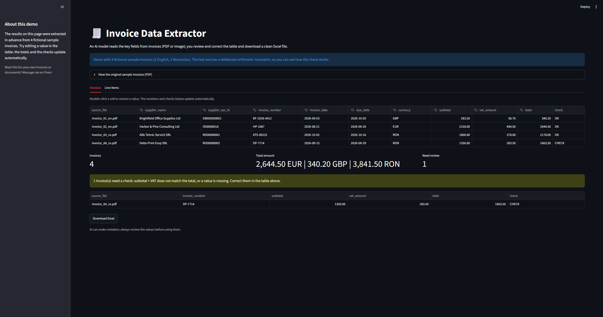

# Invoice Data Extractor

An AI model reads the key fields from invoices (PDF or image); you review and correct the table
and download a clean Excel file.

**Live demo:** _add your Streamlit link here_



## What it extracts

Supplier name and tax id (CUI/CIF or VAT number), invoice number, invoice and due date, currency,
subtotal, VAT, total, and every line item. Works with Romanian and English invoices.

Every invoice gets an arithmetic check: **OK** (subtotal + VAT = total), **CHECK** (the numbers do
not add up) or **MISSING** (a value is not on the invoice). The check updates when you edit the table.

## About the demo

The public demo shows pre-extracted results for 4 fictional sample invoices (2 English, 2 Romanian,
one with a deliberate arithmetic error). You can edit values, see the checks update, and download
the Excel file. No API key is needed and nothing is uploaded.

The extraction code (`extractor.py`) is included. It sends a PDF or image to the Anthropic API and
parses the answer. It is switched off in the public demo because it needs an API key and costs money.

## Run locally (Windows, VS Code terminal)

```powershell
python -m venv venv
venv\Scripts\activate
python -m pip install -r requirements.txt
python -m streamlit run app.py
```

## Turning on Live mode (optional)

1. `python -m pip install anthropic python-dotenv`
2. In `app.py` set `ENABLE_LIVE = True`.
3. Provide an Anthropic API key: paste it in the sidebar, or copy `.env.example` to `.env`, or
   create `.streamlit/secrets.toml` with `ANTHROPIC_API_KEY = "your-key"`. Never commit a key.
4. If you deploy it publicly, remember that anyone using Live mode spends your API credit.

## Files

| File | Purpose |
|---|---|
| `app.py` | Streamlit interface |
| `extractor.py` | Sends the file to the Anthropic API and parses the answer |
| `tables.py` | Pandas tables and the arithmetic check |
| `excel_export.py` | Builds the Excel file |
| `generate_sample_invoices.py` | Creates the fictional sample PDFs and `sample_results.json` |

## Limitations

- AI can make mistakes. Always review the values before using them in accounting.
- Blurry scans, handwriting or unusual layouts can fail or give wrong numbers.
- Password-protected PDFs and files over 20 MB are not supported.
